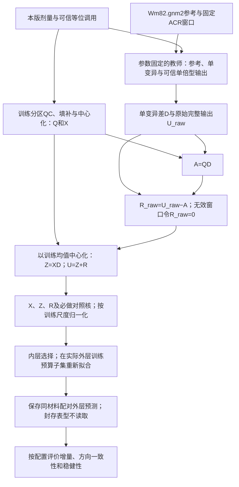

# 功能先验讲义：检验序列模型能否帮助小样本性状预测

本讲义解释[研究方案](研究方案.md)的模型及比较思路，以SoyBase种子蛋白含量任务为例。具体数据、完成条件和实际结果分别见[任务书](任务书.md)、[验收规范](验收规范.md)与[验收记录](验收记录.md)。

## 1. 为什么考虑功能先验

材料少、标记多时，单靠性状观测难以稳定估计所有位点效应。收缩方法通过先验约束这些效应。普通加性模型和已有注释方法提供不同的先验，本研究比较固定序列功能模型所提供的先验能否带来额外预测增量。

当前SoyBase目录包含41,346个核染色体双等位SNV，主实验只在配置规定的小样本预算内训练。原方案用n≈500–1000、M≈10⁷的拟南芥情形解释高维问题；这些是原设计示例，不是当前大豆数据规模。

## 2. 教师输出的方向意味着什么

教师是一个参数固定的序列功能模型。对一个窗口，它给出二分类正负logits之差F。再比较参考序列与仅替换一个SNP的序列，得到单变异功能差d。

d的正负表示教师预测分数上升或下降，连续数值表示该分数的变化幅度。它不等于实测调控变化，也不决定性状效应方向。功能预测与protein之间的关联仍需开发材料验证。

已有注释方法可以调整单个位点的先验方差。本研究进一步检验，同一窗口中功能差的乘积形成的跨位点协方差，是否优于相同教师分数的对角加权。

## 3. 从基因型到预测

先以当前训练材料的统计量处理剂量，得到Q与中心化矩阵X。参考序列和单变异序列决定D；可信单倍型决定原始完整功能输出U_raw。由A=QD得到R_raw=U_raw−A，再按同一训练均值中心化，得到Z=XD和U=Z+R。

主要回归方程在n×n核矩阵上求解，但教师推理、特征计算和构核仍需单独计算与测量成本。样本空间求解不等于全部计算都只涉及小矩阵。

## 4. 数学模型

$Q\in\mathbb R^{n\times M}$ 是训练均值填补后的剂量矩阵（原始已调用剂量为 0/1/2）：第 $i$ 行第 $j$ 列是材料 $i$ 在 SNP $j$ 上的 ALT 拷贝数；$y\in\mathbb{R}^n$ 是要预测的连续性状；$X$ 是 $Q$ 按训练折均值中心化后的矩阵，不逐位点除以等位频率标准差；测试材料使用同一训练均值，核的整体尺度另行归一化。

**教师打分。** 对第 $j$ 个 SNP，把参考单倍型 $h_0$ 与"仅替换该 SNP"的单倍型 $h_0^{(j,\mathrm{ALT})}$ 分别送入参数固定的教师 $F_\theta$，取两者输出 logit 之差：

$d_{jg}=F_g(h_{0g}^{j:\mathrm{ALT}})-F_g(h_{0g}),\qquad D\in\mathbb R^{M\times G}$

$d_{jg}$ 是第 2 节所说的预测方向与强度。D 的每列汇集一个窗口的单变异功能差，不能写成对角矩阵。教师标量 F 取二分类正负 logits 之差，类别映射须先核验。

**三路分解。** 设材料 $i$ 在窗口 $g$ 内有两个单倍型 $h_i^{(1)}, h_i^{(2)}$，定义全量功能输出、参考锚定成分与余项：

$U_{raw,ig}=F_g(h_{ig}^{(1)})+F_g(h_{ig}^{(2)})-2F_g(h_{0g}),\qquad A=QD,\qquad R_{raw}=U_{raw}-A$

一阶功能特征 $Z=XD$：每列是一个窗口内位点的中心化剂量与功能差的加权和。无效样本—窗口令原始 $R_{raw}=0$、$U_{raw}=A$，保留有效性掩码，再统一按训练均值中心化；这不表示中心化后的无效行仍为零。

**模型。** 性状被写成三个高斯随机效应与一个残差之和：

$y \;=\; \mu\mathbf{1} + f_A + f_F + f_R + \varepsilon, \qquad f_s \sim \mathcal{N}\big(0,\; w_s K_s\big), \qquad \varepsilon \sim \mathcal{N}(0,\sigma^2 I)$

三个核分别由 X、Z、R 构造，统一使用第 3 节的训练迹归一化。给定非负、和为 1 的核权重，$K_w=\sum_s w_sK_s$；令 $\lambda=n\rho$，核岭解为 $\alpha=(K_w+n\rho I)^{-1}(y-\bar y_T\mathbf1)$，预测为 $\bar y_T+\sum_s w_sK_{s,*T}\alpha$。上面的随机效应表述可在相同核尺度、噪声方差 $\sigma^2=n\rho$ 下对应此解；权重的选择仍以预测误差为依据。

**估计与调参。** 给定权重和正则化强度后，目标函数有闭式解。候选网格只维护于[配置](../configs/funcprior.toml)，内层选择配置，外层评价；QC、填补、窗口可用性和中心化都仅由当前训练分区拟合。外部窗口的初始选择不读取表型。测试交叉核为 $K_{s,*T}=B_{s,*}B_{s,T}^\top/c_s$。

**去留标准。** 按[研究方案 §6](研究方案.md)比较最强加性流程及各必做对照，同时检查外层方向一致性与完整覆盖稳健性。预算阈值未达到或区间过宽时，不支持继续扩大，不能据此证明先验普遍无效。

## 5. 分解如何改变先验

功能核为 $K_F=XDD^\top X^\top/c_F$。忽略整体尺度时，它对应位点效应先验 $\operatorname{Cov}(b)=\tau_AI+\tau_FDD^\top$。同一窗口内两位点的功能差相乘可产生正或负的非对角协方差，这才是本方案要检验的方向信息。

若把 D 错写成对角阵，核中只剩 $d_j^2$，符号会消失，模型退化为对角注释加权。必做对照 $K_D$ 正是保留 $DD^\top$ 的对角、去掉非对角项，再按自己的训练尺度归一化。M1 不优于该对照时，不能主张跨位点共享带来增益。

M2 的表示还可重写成 X 与 U 的线性读出；分解改变的是联合先验，不扩大线性函数集合。它与完整功能核路线的区别须通过 MU 等对照评价，不能由训练拟合推断生物机制。

## 6. 为什么需要这些对照

M0与EN代表强加性选择，MD保留教师分数的对角权重，MP置乱局部映射。它们用于判断收益是否需要跨位点功能协方差。

MU、MW与MWG使用完整功能输出；MHap与MLocal提供普通单倍型和局部非线性表示。MI保留无教师权重的局部交互，MRPerm置乱教师高阶系数。这些比较用于判断余项分解和教师权重是否增加预测价值，不能单凭某个对照结果推断生物机制。

完整调用材料和替代参考锚点的分析检查结果是否依赖缺失覆盖或特定背景。阈值与全部对照定义以[验收规范](验收规范.md)及[配置](../configs/funcprior.toml)为准。

## 7. 可以得到什么结论

研究结果可以说明，在本队列、芯片目录、教师和主性状条件下，功能先验是否值得继续研究。未达到预注册增量或区间过宽时，应分别报告负结果、比较缺口或尚无法判断。

预测改善不能证明因果调控，核权重不能解释为遗传率或方差组分，单队列结果不能自动推广到其他性状或群体。本研究也不以组合已有模型来宣称新的模型原理。
