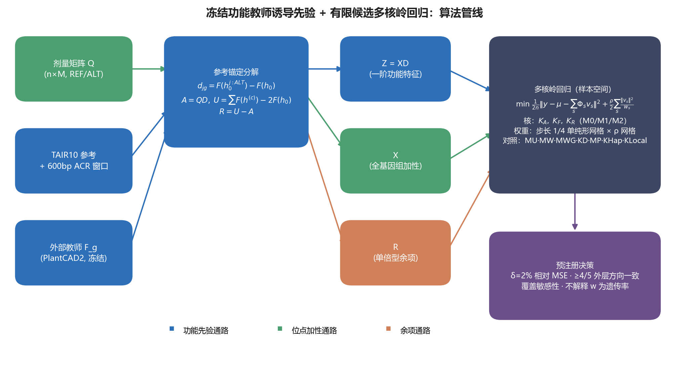

# 新算法讲义：用功能模型的"方向感"改进小样本基因组预测

> 本讲义解释[研究方案](研究方案.md)的核心想法；数学定义与[验收规范](验收规范.md)一致，运行参数只维护于[配置](../configs/funcprior.toml)。文中拟南芥例子属于原设计，当前 SoyBase protein 的执行安排见[任务书](任务书.md)，仓库入口见 [README](../README.md)。

---

## 1\. 一个问题：SNP 太多，材料太少

拟南芥育种和数量遗传研究里常见这样的局面：要预测的连续性状（比如开花时间），可用的训练材料只有几百到一千株，而全基因组有大约一千万个 SNP。用 $n$ 记材料数、$M$ 记 SNP 数，就是 $n\approx 500\text{–}1000$，$M\approx 10^7$，未知数比方程多四个数量级。

标准方法 GBLUP 的做法是给所有 SNP 效应加一个同样的正态先验，等价于认为"每个 SNP 对性状的影响方向和大小完全未知，但幅度都差不多"。在这个尺度下模型能学的极其有限，实际起决定作用的是先验形状——正则化把估计往哪里收缩。先验越贴近真实遗传结构，预测越好；一视同仁的先验，等于浪费了已经积累的生物学知识。

问题在于，我们手里明明有大量调控功能知识（哪些区域是调控元件、序列模型对每个变异的功能影响），却用不进去——不是不想用，而是缺少一个能把"功能知识"翻译成"效应先验"的、可检验的形式。这就是本方案的出发点。

## 2\. 一个观察：功能模型知道变异"往哪边推"

近年的植物序列基础模型（本方案用 PlantCAD2）可用于预测染色质开放区域（ACR）：给它一段指定长度的 DNA 序列，它输出任务相关的预测分数，也能比较"参考序列"和"突变序列"两种输入，输出一个 logit 差。这个差值就是我们要用的核心量，记作 $d$，称为单变异功能差。

$d$ 有两个宝贵的性质。第一，它有符号：$d>0$ 表示该变异提高教师预测的 ACR logit，$d<0$ 表示降低；这不是实测调控功能。第二，它是连续的：强度有大有小。一些注释加权模型只改变位点效应的方差。本方案检验同一窗口内功能差的乘积是否提供额外的跨位点协方差信息，不能把所有既有先验方法概括为二值注释。

但 $d$ 描述的是**教师预测功能**的变化，不是性状效应。教师认为某变异降低 ACR 分数，并不意味着开花提前或产量下降。功能到性状的映射仍需开发数据检验，所以 d 只能作为先验使用；有限样本不能保证纠正错误的教师方向。

## 3\. 核心想法：让功能模型出"方向"，让数据当"裁判"

把上面的观察压缩成一句话：**用功能模型给每个 SNP 标注一个方向性先验，用多核岭回归让训练数据决定信多少。** 具体分三步。

第一步，算 $d$。对每个窗口内的 SNP，把参考窗口序列和仅替换该 SNP 的序列分别送入固定教师，取功能输出之差 $d_{jg}$。教师参数全程不更新，不参与拟合性状。

第二步，构造功能分解。$D\in\mathbb R^{M\times G}$ 是“位点 × 窗口”矩阵，元素 $d_{jg}$ 表示位点 j 在窗口 g 参考背景上的功能差，窗口外为零。原始一阶功能输出为 $A=QD$，完整个人功能输出为 U，余项为 $R_{raw}=U_{raw}-A$。用训练均值中心化后有 $Z=XD$、$U=Z+R$；A 和 Z 是同一功能项在中心化前后的表示。

第三步，组合三个预测通路：原始剂量的加性背景 X、中心化一阶功能项 Z、中心化教师余项 R。令 $B_s\in\{X,Z,R\}$，每个核都用训练统计量 $c_s=\|B_s\|_F^2/n$ 归一化为 $K_s=B_sB_s^\top/c_s$；零信号核关闭。权重由内层验证选择，只代表预测配置，不能解释为遗传率或方差组分。

配图为概念示意，精确特征定义、核尺度和缺失处理以研究方案为准。

到这一步，架构就完整了：输入是基因型，中间是教师提供的方向性先验，输出是性状预测。全部计算在 $n\times n$ 的核矩阵上完成，一千万个 SNP 从不显式展开成回归系数。

## 4\. 数学模型

记号先定下来。$Q\in\mathbb R^{n\times M}$ 是训练均值填补后的剂量矩阵（原始已调用剂量为 0/1/2）：第 $i$ 行第 $j$ 列是材料 $i$ 在 SNP $j$ 上的 ALT 拷贝数；$y\in\mathbb{R}^n$ 是要预测的连续性状；$X$ 是 $Q$ 按训练折均值中心化后的矩阵，不逐位点除以等位频率标准差；测试材料使用同一训练均值，核的整体尺度另行归一化。

**教师打分。** 对第 $j$ 个 SNP，把参考单倍型 $h_0$ 与"仅替换该 SNP"的单倍型 $h_0^{(j,\mathrm{ALT})}$ 分别送入参数固定的教师 $F_\theta$，取两者输出 logit 之差：

$d_{jg}=F_g(h_{0g}^{j:\mathrm{ALT}})-F_g(h_{0g}),\qquad D\in\mathbb R^{M\times G}$

$d_{jg}$ 是第 2 节所说的预测方向与强度。D 的每列汇集一个窗口的单变异功能差，不能写成对角矩阵。教师标量 F 取二分类正负 logits 之差，类别映射须先核验。

**三路分解。** 设材料 $i$ 在窗口 $g$ 内有两个单倍型 $h_i^{(1)}, h_i^{(2)}$，定义全量功能输出、参考锚定成分与余项：

$U_{raw,ig}=F_g(h_{ig}^{(1)})+F_g(h_{ig}^{(2)})-2F_g(h_{0g}),\qquad A=QD,\qquad R_{raw}=U_{raw}-A$

一阶功能特征 $Z=XD$：每列是一个窗口内位点的中心化剂量与功能差的加权和。无效样本—窗口令原始 $R_{raw}=0$、$U_{raw}=A$，保留有效性掩码，再统一按训练均值中心化；这不表示中心化后的无效行仍为零。

**模型。** 性状被写成三个高斯随机效应与一个残差之和：

$y \;=\; \mu\mathbf{1} + f_A + f_F + f_R + \varepsilon, \qquad f_s \sim \mathcal{N}\big(0,\; w_s K_s\big), \qquad \varepsilon \sim \mathcal{N}(0,\sigma^2 I)$

三个核分别由 X、Z、R 构造，统一使用第 3 节的训练迹归一化。给定非负、和为 1 的核权重，$K_w=\sum_s w_sK_s$；令 $\lambda=n\rho$，核岭解为 $\alpha=(K_w+n\rho I)^{-1}(y-\bar y_T\mathbf1)$，预测为 $\bar y_T+\sum_s w_sK_{s,*T}\alpha$。上面的随机效应表述可在相同核尺度、噪声方差 $\sigma^2=n\rho$ 下对应此解；权重的选择仍以预测误差为依据。

**估计与调参。** 给定权重和正则化强度后，目标函数有闭式解。候选网格只维护于[配置](../configs/funcprior.toml)，内层选择配置，外层评价；QC、填补、窗口可用性和中心化都仅由当前训练分区拟合。外部窗口的初始选择不读取表型。测试交叉核为 $K_{s,*T}=B_{s,*}B_{s,T}^\top/c_s$。

**去留标准。** 按[研究方案 §6](研究方案.md)比较最强加性流程及各必做对照，同时检查外层方向一致性与完整覆盖稳健性。预算阈值未达到或区间过宽时，不支持继续扩大，不能据此证明先验普遍无效。

## 5\. 一个关键等价：差别只在先验几何

功能核为 $K_F=XDD^\top X^\top/c_F$。忽略整体尺度时，它对应位点效应先验 $\operatorname{Cov}(b)=\tau_AI+\tau_FDD^\top$。同一窗口内两位点的功能差相乘可产生正或负的非对角协方差，这才是本方案要检验的方向信息。

若把 D 错写成对角阵，核中只剩 $d_j^2$，符号会消失，模型退化为对角注释加权。必做对照 $K_D$ 正是保留 $DD^\top$ 的对角、去掉非对角项，再按自己的训练尺度归一化。M1 不优于该对照时，不能主张跨位点共享带来增益。

M2 的表示还可重写成 X 与 U 的线性读出；分解改变的是联合先验，不扩大线性函数集合。它与完整功能核路线的区别须通过 MU 等对照评价，不能由训练拟合推断生物机制。

## 6\. 它是怎么被提出来的

这套方案不是从灵感来的，是从文献核查的失败记录里收敛出来的。研究方案记录了收缩后的问题与对照设计，这里只讲推理链。

最初的设想是直接改造序列模型架构去预测性状。研究方案列出的 WMKRR、Epi\-PRS 和 IFAM 等近邻，使问题收缩到：**固定植物功能模型诱导的协方差，相对对角注释和完整个人功能表征，是否提供预测增量**。这是待检验的经验问题；文献审计附件尚未随目录提供，不能据现有材料断言没有发表先例。

第二个收缩来自教师可信度：预测功能差不等于性状效应，教师可能错配目标性状。匹配置乱对照 MP 在每窗口内按训练 MAF 分层置乱 d 的对应关系，检验局部功能映射的价值；它不是只翻转符号，也不能独自证明生物机制。

第三个收缩是分解的必要性。个人功能输出分为中心化一阶项 Z 与余项 R，并保留原始剂量背景 X，便于比较先验结构与失效模式。A 是 Z 中心化前的表示，不是另一条独立通路；分解不提供机制识别保证。

至此方案定型：承认组件全部已知，把新颖性和价值全部押在组合与可证伪的实验设计上。

## 7\. 它能解决什么，不能解决什么

能解决的，是一个被明确限定的问题：**在严格隔离的植物性状任务上，量化参数固定功能模型诱导的有符号协方差，相对普通加性核、无符号注释核、单倍型核的增量与失败边界。**继续与停止规则见[研究方案 §6](研究方案.md)，它们是预算下的开发判据，不是已证实的增益范围或普适有效性阈值。

它不能发现因果机制，核权重只能解释为预测配置；教师错配可能导致失败，单一性状的结果不能自动外推到其他性状或群体。

## 8\. 贡献与定位

若实验成立，贡献是量化特定植物性状任务中的预测增量、先验差异与失败边界。不能宣称首创功能先验、多核求解或单倍型非加性，也不能从一次数据集的结果推断普遍增益上界。

若实验未支持扩大，应区分教师错配、表示覆盖、样本功效和比较未完成等原因，交付可复用实现及停止依据，不承诺发表结果。

---

## 延伸阅读

- [研究方案](研究方案.md)：数学定义、决策依据和科学比较。
- [验收规范](验收规范.md)：输入合同、对照定义和验收要求。
- [配置](../configs/funcprior.toml)：唯一运行参数来源。
